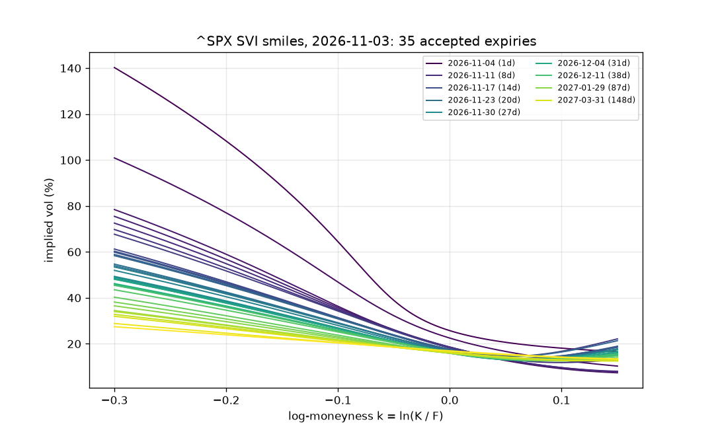
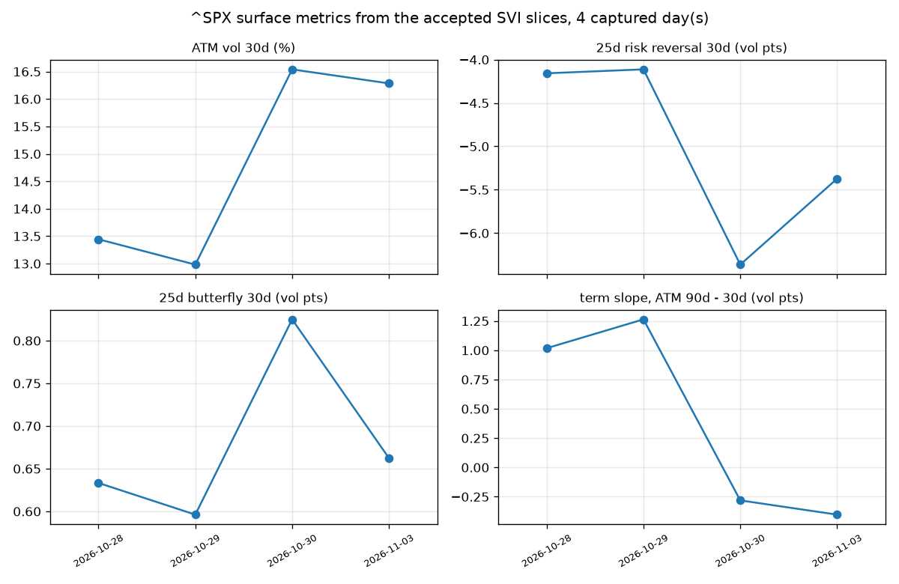
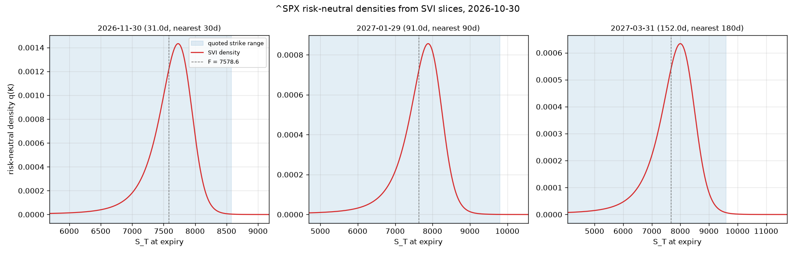
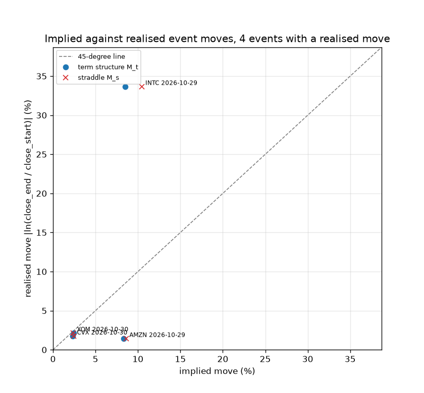
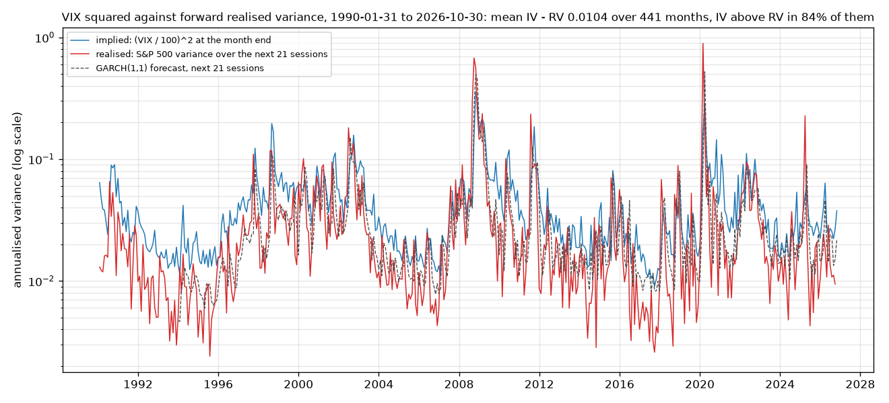
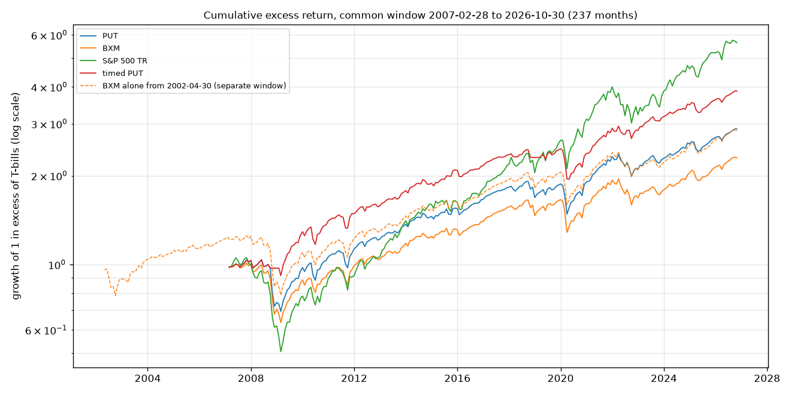
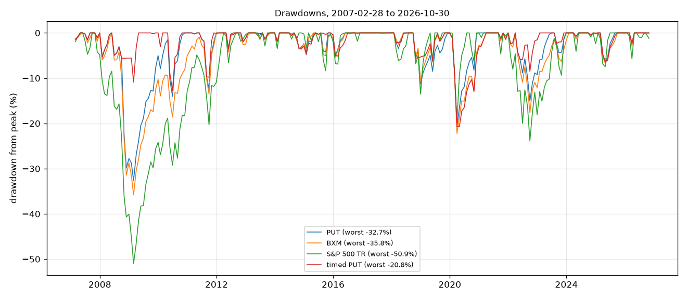
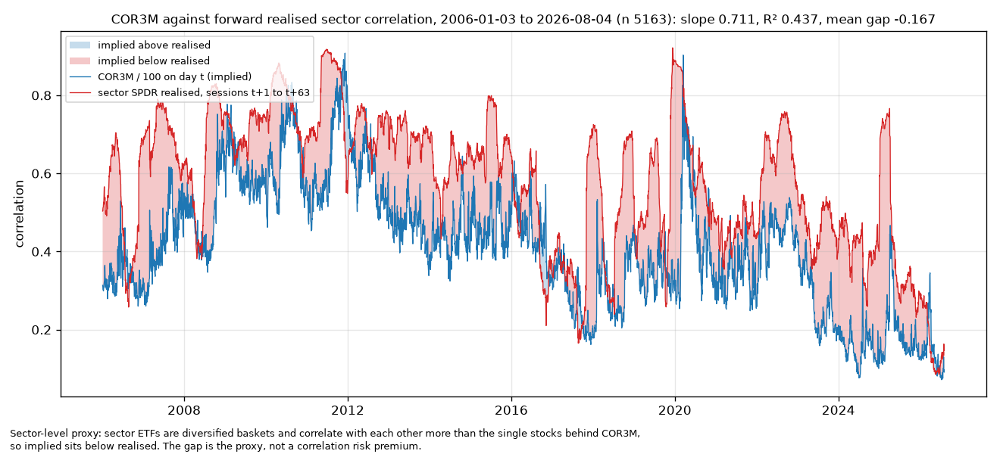

# Volatility Surface and Event Pricing

Prices listed options and their Greeks, solves implied volatility, and fits an arbitrage-free SVI and SSVI surface per underlying.
Reads the risk-neutral distribution off the surface and measures the move options price around earnings and macro events.
Tests the volatility risk premium on S&P 500 history from 1990 and implied against realised correlation from Cboe COR3M.
Splits delta-hedged option P&L into Greeks and builds a 1-page daily risk report.
Option chains are captured daily from 2026-10-28, so every live result is a method demonstration with its N stated.

Results are in [`outputs/`](outputs/). [](https://github.com/uty101/Volatility-Surface-and-Event-Pricing/actions/workflows/ci.yml) 4,729 tests.

**Capture window:** 2026-10-28 to 2026-11-03, 4 days, 2026-11-02 missed. The first day holds `^SPX`, SPY and AAPL only, from an in-session test capture. The others hold all 37 underlyings.

## Run it

```bash
uv venv --python 3.12
uv pip install -r requirements-lock.txt
uv pip install -e . --no-deps
python scripts/run_all.py                  # every stage, in section order
pytest -p socket --disable-socket -q
```

`run_all.py` needs an authenticated `gh` to download the chains from the `snapshots` release. Long history is committed in `data/raw/`. Fitted surfaces are cached in `data/processed/surface/`, so only new days are fitted. Methods are in [`docs/METHODS.md`](docs/METHODS.md).

## 1. Does the pricer match QuantLib?

Yes. BSM matches QuantLib's analytic engine: the largest price gap is 3.9e-14 over 252 grid cases, against a bound of 1e-10. Black-76 equals BSM once S e^(−qT) = D F: the largest gap is 5.0e-14 over 252 cases. The American CRR tree at 2000 steps matches QuantLib's CRR engine: the largest gap is 6.8e-05 x S over 252 cases, against a bound of 1e-4 x S. Delta, gamma, vega, theta and rho match QuantLib: the largest gap is 4.4e-13 over 252 cases each, against a bound of 1e-8. Early exercise premium on SPY near the money puts: median 0.22 vol points (N = 496 contracts, fixture day). It grows on SPY deep in the money puts: median 1.39 vol points (N = 44 contracts). Early exercise premium on AAPL near the money puts: median 0.16 vol points (N = 47 contracts, fixture day). It grows on AAPL deep in the money puts: median 4.79 vol points (N = 109 contracts). On calls it is 0 to rounding: the largest median in any SPY or AAPL call bin is 7.7e-12 vol points. The single names captured later have no premium table, because the step runs on the fixture day, which holds SPY and AAPL only.

## 2. The S&P 500 surface

^SPX 30-day ATM vol was 13.44% on 2026-10-28 (N = 4 capture days). It was 16.28% on 2026-11-03, after the 2026-10-30 sell-off. The 30-day 25-delta risk reversal went from −4.16 to −5.37 vol points, so skew steepened (N = 4 days). The term slope, ATM 90 days minus 30 days, went from 1.02 to −0.40 vol points, so the short end moved above the long end (N = 4 days). Butterfly: 1550 of 1683 SVI slices across every underlying and day are accepted; the rest are rejected or have too few quotes to fit (N = 4 days). Every accepted slice is free of butterfly arbitrage up to the check's tolerance: the smallest g on the acceptance grid is −9.5e-11, against −1e-10. Calendar: the per-expiry slices are not fully clean. 13 of 134 consecutive ^SPX pairs cross somewhere on their shared quoted range (N = 4 days). Across every underlying it is 41 of 1436 pairs. Slices are not refitted for this; SSVI is the calendar-consistent surface, because its theta is non-decreasing in T by construction. SSVI pays for that in fit: its ^SPX RMSE was 3.16 vol points on 2026-11-03, because 1 rho cannot hold the skew, so the daily metrics come from the slices.

| day | ATM 30d % | RR 25d, pts | BF 25d, pts | ATM 90d % | term slope, pts | expiries |
| --- | --- | --- | --- | --- | --- | --- |
| 2026-10-28 | 13.44 | −4.16 | 0.63 | 14.46 | 1.02 | 36 |
| 2026-10-29 | 12.98 | −4.11 | 0.60 | 14.25 | 1.26 | 34 |
| 2026-10-30 | 16.54 | −6.36 | 0.82 | 16.26 | −0.28 | 34 |
| 2026-11-03 | 16.28 | −5.37 | 0.66 | 15.88 | −0.40 | 34 |

The smile on the last day shows the skew the slices hold: the 30-day 25-delta risk reversal is −5.37 vol points.



ATM vol jumped on 2026-10-30 and stayed up, ending at 16.28%, with the term slope turning negative.



The density comes straight from each slice, and the shaded band marks where quotes exist. Tail probabilities outside it are labelled extrapolated.



## 3. Earnings events

With N = 4 completed events, fewer than the 20 the summary needs, the gap between implied and realised moves cannot be told apart from 0 at this N. AMZN AMC 2026-10-29: realised 1.42% against a term structure move of 8.32% and a straddle move of 8.59%, ratio 0.17. INTC AMC 2026-10-29: realised 33.65% against a term structure move of 8.51% and a straddle move of 10.48%, ratio 3.95. CVX BMO 2026-10-30: realised 1.74% against a term structure move of 2.34% and a straddle move of 2.43%, ratio 0.74. XOM BMO 2026-10-30: realised 2.14% against a term structure move of 2.42% and a straddle move of 2.39%, ratio 0.88. 38 more events have a window that ends after the last close in the data and stay pending. 3 events have no pre-event snapshot, because they fall before the capture could see them.

| ticker | date | timing | straddle % | term structure % | realised % | ratio |
| --- | --- | --- | --- | --- | --- | --- |
| AMZN | 2026-10-29 | AMC | 8.59 | 8.32 | 1.42 | 0.17 |
| INTC | 2026-10-29 | AMC | 10.48 | 8.51 | 33.65 | 3.95 |
| CVX | 2026-10-30 | BMO | 2.43 | 2.34 | 1.74 | 0.74 |
| XOM | 2026-10-30 | BMO | 2.39 | 2.42 | 2.14 | 0.88 |

Points above the line moved more than the options priced. 4 points say nothing about the average.



## 4. The volatility risk premium

VIX squared sat above the variance that followed by 0.01037 of annualised variance on average, over 441 months from 1990. Over the 394 months that also have a GARCH forecast the mean gap is 0.00970. Implied variance is above the GARCH forecast in 362 of 395 month ends. The forecast says little about the size of the gap: the correlation of the signal with the later gap is 0.15 over 394 months. Selling puts paid, but less per unit of risk than holding the index: Cboe PUT has a Sharpe of 0.56 over 237 months from 2007, against 0.65 for the S&P 500 total return index and 0.44 for BXM. The index carries no trading costs of its own, so the only cost deducted here is the timed strategy's switching cost. PUT's worst month was −17.65%. Timing on implied minus GARCH variance gives a raw Sharpe of 0.80 over 237 months, after the switching cost. The deflated Sharpe beside it is blank, with status too_few_trials, because 1 specification was tried and the deflation needs at least 2. So the number of specifications tried is 1, and the raw figure is 1 specification of a family, not evidence that timing improves the deflated Sharpe. The raw gain over PUT comes from sitting out 27 months.

| strategy | months | mean % | vol % | Sharpe | worst month % | worst drawdown % | skew | excess kurtosis |
| --- | --- | --- | --- | --- | --- | --- | --- | --- |
| put | 237 | 7.52 | 10.72 | 0.555 | −17.65 | −32.66 | −1.69 | 7.41 |
| bxm | 237 | 6.39 | 10.95 | 0.441 | −15.01 | −35.81 | −1.36 | 5.24 |
| sp500tr | 237 | 11.55 | 15.40 | 0.648 | −16.80 | −50.95 | −0.55 | 1.05 |
| timed_put | 237 | 8.85 | 9.06 | 0.803 | −13.42 | −20.75 | −1.03 | 5.48 |
| bxm_long | 295 | 6.57 | 10.64 | 0.455 | −15.01 | −35.81 | −1.26 | 5.11 |

`bxm_long` is BXM alone over its longer window. VIX squared sat above the variance that followed in 372 of 441 months.



The timed line ends highest of the option strategies, with a Sharpe of 0.80 against PUT's 0.56. That is 1 specification, so read it with the deflated Sharpe note above.



Its worst drawdown is −20.8% against PUT's −32.7%, because it was out of the market for part of the falls.



## 5. Correlation

Yes, in part. Regressing the next 63 sessions' realised sector correlation on COR3M gives a slope of 0.711 (Newey-West se 0.074), N = 5163 days. R² is 0.437, so COR3M accounts for a bit under half of the variation in next quarter's realised correlation (N = 5163 days). The mean gap, implied minus realised, is −0.167. COR3M covers single stocks and this proxy uses sector ETFs, which correlate with each other more, so implied sits below realised; the gap is the proxy, not a correlation risk premium. The XLK chain priced an implied correlation of 0.496 on 2026-11-03, with 15 names covering 72.0% of the weight (N = 3 days with a value). It rose from 0.331 on 2026-10-29 to 0.565 on 2026-10-30, when the S&P 500 fell 1.8% and XLK 4.9%. Implied correlation rising in a sell-off is the textbook pattern.

| days | first | last | intercept | slope | slope se | R² |
| --- | --- | --- | --- | --- | --- | --- |
| 5163 | 2006-01-03 | 2026-08-04 | 0.2862 | 0.7115 | 0.0740 | 0.4373 |

| day | XLK vol % | names | covered weight % | implied correlation |
| --- | --- | --- | --- | --- |
| 2026-10-29 | 25.24 | 15 | 72.0 | 0.331 |
| 2026-10-30 | 33.72 | 13 | 66.1 | 0.565 |
| 2026-11-03 | 32.18 | 15 | 72.0 | 0.496 |

Implied and realised move together, with a slope of 0.711 and an R² of 0.437. The shaded gap is the sector proxy, not a premium.



## 6. P&L attribution and hedging

On the live delta-hedged ^SPX straddles the median explained share is 0.977 (N = 6 position moves, a method demonstration). On a synthetic Black-Scholes path it is 0.952 (N = 21 daily steps). Gamma summed to −58.35 index points per straddle unit over the 6 live moves. Theta summed to 59.76 index points per straddle unit over the 6 live moves. Vega summed to −17.37 index points per straddle unit over the 6 live moves. The residual summed to 4.19 index points per straddle unit over the 6 live moves. Delta and the hedge cancel and vanna and volga are small, so the delta-hedged P&L summed to −9.92 over the same 6 moves. Hedging every step (k = 1) leaves an error sd of 0.241 under GBM. The same hedge leaves 0.813 under Heston: the hedge uses delta at the current vol but is blind to vol moves, so even continuous hedging leaves an unhedged vega P&L, and the error sd stops falling in proportion to the square root of k. The means are not comparable, because the 2 drifts differ. Hedging less often raises the GBM error sd to 1.763 at k = 65, 5 days between hedges. It cuts cost: the GBM mean cost falls from 0.106 at k = 1 to 0.014 at k = 65.

| model | k | error mean | error sd | cost mean |
| --- | --- | --- | --- | --- |
| gbm | 1 | 0.002 | 0.241 | 0.106 |
| gbm | 13 | 0.002 | 0.862 | 0.029 |
| gbm | 65 | 0.012 | 1.763 | 0.014 |
| heston | 1 | 0.001 | 0.813 | 0.104 |
| heston | 13 | −0.010 | 1.166 | 0.029 |
| heston | 65 | −0.008 | 1.947 | 0.014 |

## Risk report

[`outputs/reports/risk_2026-11-03.pdf`](outputs/reports/risk_2026-11-03.pdf) is the 1-page report for 2026-11-03 (N = 4 capture days). Each vol is the contract's own SVI slice at its strike.

| contract | side | contracts | vol % | vol source | dollar delta | dollar gamma 1% | vega per pt |
| --- | --- | --- | --- | --- | --- | --- | --- |
| ^SPX 2026-12-03 P 7300 | −1 | 10 | 19.76 | svi | 1845546 | −418425 | −6800 |
| ^SPX 2026-12-03 C 7800 | −1 | 10 | 14.25 | svi | −1876786 | −585374 | −6862 |
| AAPL 2027-01-15 C 335 | 1 | 20 | 24.56 | svi | 334438 | 24075 | 1186 |
| NVDA 2026-12-18 P 193 | −1 | 15 | 46.31 | svi | 92455 | −6670 | −388 |

The worst cell of the grid loses 447.4 thousand dollars, at spot −10% and vol +5 points. 1 of 9 limits is breached: ^SPX dollar gamma of 1,003,799 against 250,000, which the short wings produce and the report is meant to show.

## What this does not do

- The live window is a few weeks, so nothing built on captured chains is a statistical result.
- Option prices are Yahoo's delayed quotes at 15:30 New York, not exchange data.
- The COR3M comparison is a sector proxy, because COR3M covers single stocks and the realised side uses sector ETFs.
- The timed PUT result is 1 specification of a family.
- The risk book is a sample, not a real portfolio.

`instructions/`, `review/`, `decisions/` and `PLAN.md` are the record of how this was built. The source outline is in [`project_outline/`](project_outline/). MIT licence, see [`LICENSE`](LICENSE).
